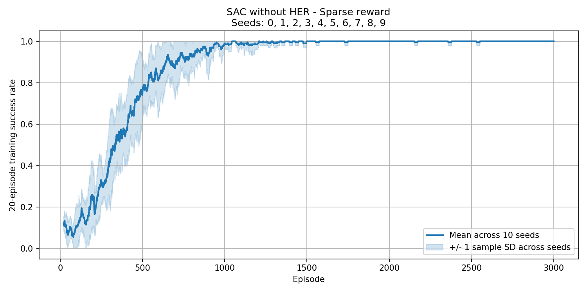
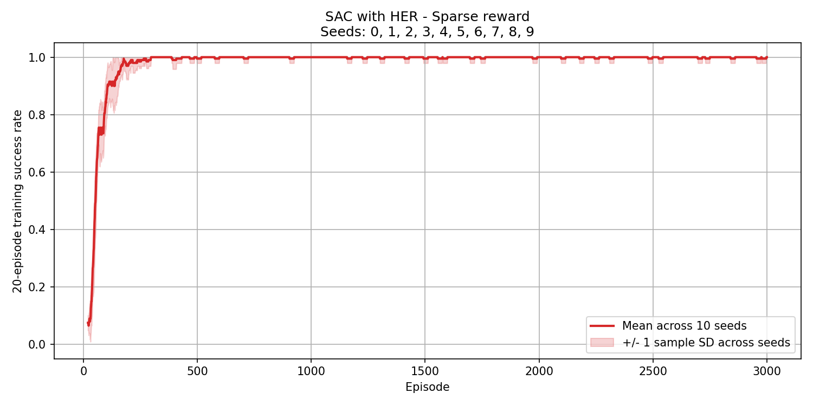
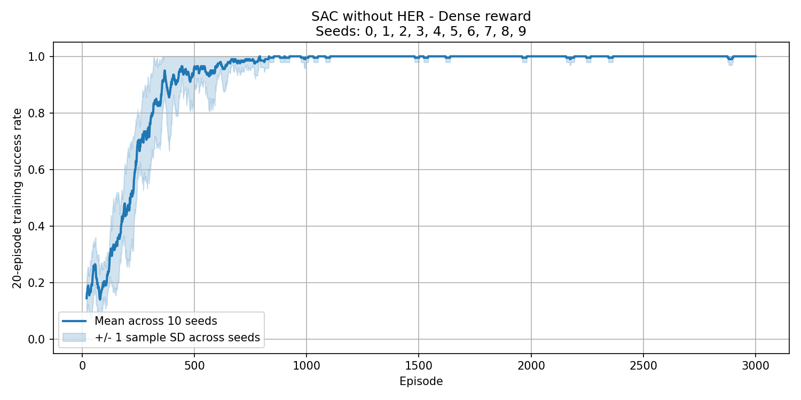
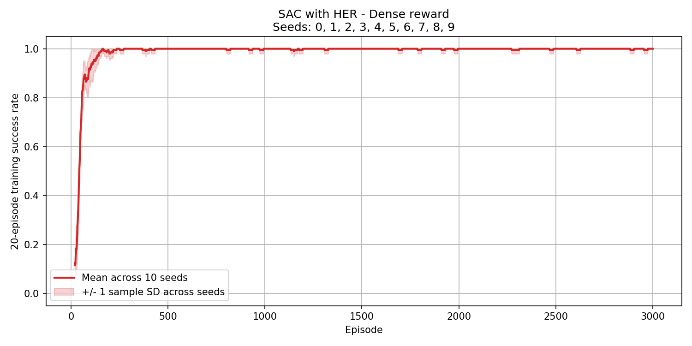

# Unitree G1: SAC + Hindsight Experience Replay

MuJoCo의 Unitree G1 로봇이 목표 위치에 도달하도록 Soft Actor-Critic(SAC)을 학습하고,
Hindsight Experience Replay(HER)의 효과를 비교하는 프로젝트입니다.
희소보상/조밀보상과 HER 사용 여부를 조합한 4개 조건을 각각 10개 시드로 실행합니다.

상위 SAC 정책은 현재 위치와 목표 위치를 받아 2차원 속도 명령을 출력합니다.
고정된 Unitree G1 보행정책이 이 명령을 12개 관절의 제어로 변환합니다.
학습 대상은 상위 SAC 정책이며, 실험은 MuJoCo 시뮬레이션에서 수행합니다.

## 실험 구성

| 조건 | 보상 | HER | 실행 스크립트 |
| --- | --- | --- | --- |
| `noher` | 희소보상 | 사용 안 함 | `train_noher.py` |
| `her` | 희소보상 | future strategy, `k=4` | `train_her.py` |
| `dense_noher` | 조밀보상 | 사용 안 함 | `train_dense_noher.py` |
| `dense_her` | 조밀보상 | future strategy, `k=4` | `train_dense_her.py` |

- 기본 시드: `0, 1, 2, 3, 4, 5, 6, 7, 8, 9`
- 시드당 3,000에피소드, 에피소드당 최대 128스텝
- 전체 실행량: 40회 학습, 120,000에피소드
- 매 실행마다 SAC 모델, 옵티마이저, 리플레이 버퍼와 환경을 새로 생성
- 같은 시드의 네 조건은 같은 목표 생성 순서와 공통 하이퍼파라미터 사용

## 학습 결과

저장된 `history.csv`와 `run_config.json`을 확인한 결과, 네 조건 모두 시드 0~9의
3,000에피소드 학습이 완료되어 있습니다. 다음 수치는 시드별 전체 에피소드 성공률의
평균 ± 시드 간 표본 표준편차입니다. 단위는 %이며 표준편차는 퍼센트포인트입니다.

| 조건 | 시드 수 | 시드당 에피소드 | 전체 학습 성공률 |
| --- | ---: | ---: | ---: |
| SAC · 희소보상 | 10 | 3,000 | 87.79 ± 2.33 |
| SAC + HER · 희소보상 | 10 | 3,000 | 98.06 ± 0.23 |
| SAC · 조밀보상 | 10 | 3,000 | 93.05 ± 1.46 |
| SAC + HER · 조밀보상 | 10 | 3,000 | 98.63 ± 0.13 |

마지막 20에피소드의 성공률은 네 조건 모두 모든 시드에서 100%입니다.
표와 그래프는 학습 중 성공률이며 별도의 평가 실험 결과가 아닙니다.

| 희소보상 · SAC | 희소보상 · SAC + HER |
| --- | --- |
|  |  |

| 조밀보상 · SAC | 조밀보상 · SAC + HER |
| --- | --- |
|  |  |

실선은 각 시드의 20에피소드 이동평균 성공률을 같은 에피소드에서 평균한 값입니다.
음영은 시드 간 표본 표준편차 ±1이며, 표시 범위 0~1에서 잘라 그립니다.
신뢰구간을 뜻하지 않으며, 시드가 하나면 음영을 그리지 않습니다.
에피소드 수가 20보다 작으면 해당 에피소드 수를 창 크기로 사용합니다.

`graphs/`는 GitHub에서 확인할 수 있는 결과 이미지 폴더입니다.
원시 학습 기록과 체크포인트는 `.gitignore`의 `results/`, `checkpoints/` 규칙으로 제외됩니다.
새로 받은 저장소에서 재집계하거나 정책을 재생하려면 해당 결과 파일을 별도로 준비하거나 학습해야 합니다.

## 설치

### Python 환경

실험한 환경은 Linux x86_64, Python 3.8.20, PyTorch 1.13.1 / CUDA 11.7입니다.
[requirements.txt](requirements.txt)는 코드가 직접 사용하는 다섯 패키지의 버전을 고정합니다.

| 패키지 | 버전 | 용도 |
| --- | --- | --- |
| `torch` | 1.13.1 | SAC 학습, TorchScript 보행정책 실행 |
| `numpy` | 1.24.4 | 수치 연산, 난수 생성, 리플레이 버퍼 |
| `mujoco` | 3.2.3 | G1 물리 시뮬레이션, 뷰어 |
| `matplotlib` | 3.7.3 | 성공률과 시드 평균 그래프 |
| `PyYAML` | 6.0.2 | 실험 및 Unitree 설정 읽기 |

Conda와 Git을 준비한 뒤 저장소를 내려받고 프로젝트 루트로 이동합니다.

```bash
git clone https://github.com/mjjo2564-droid/g1-hindsight-sac.git
cd g1-hindsight-sac
```

이후 설치와 실행 명령은 `README.md`가 있는 프로젝트 루트를 기준으로 합니다.

```bash
conda env create -f environment.yml
conda activate g1-her
python -m pip install -r requirements.txt
python -m pip check
```

이미 `g1-her` 환경이 있다면 환경 생성 단계는 생략합니다.
[environment.yml](environment.yml)은 Python과 PyTorch/CUDA 환경을 구성하고,
`requirements.txt`는 직접 의존성 버전을 맞춥니다. 전체 전이 의존성의 잠금 파일은 아닙니다.

```bash
python -c 'import torch; print("torch:", torch.__version__, "CUDA build:", torch.version.cuda, "available:", torch.cuda.is_available())'
```

기본 설정은 상위 SAC에 CUDA, 저수준 보행정책에 CPU를 사용합니다.
CUDA를 사용할 수 없으면 코드가 CPU로 전환하며 메시지를 출력합니다.
CPU를 명시하려면 `config.yaml`에서 `sac_device: cpu`로 설정합니다.
학습은 기본적으로 화면 없이 실행하며, `--render`와 체크포인트의 화면 재생에는 GUI 환경이 필요합니다.

### Unitree 모델과 보행정책

`third_party/`는 Git에서 제외되므로 새로 받은 저장소에서는 자산 설치가 필요합니다.

```bash
bash setup_unitree.sh
```

설치 스크립트는 [Unitree RL Gym](https://github.com/unitreerobotics/unitree_rl_gym)의
커밋 `276801e46c5d433564f24658bac64f254b7d2d4b`를 가져옵니다.
환경은 다음 파일과 모델이 참조하는 메시 자산을 사용합니다.

```text
third_party/unitree_rl_gym/
├── deploy/deploy_mujoco/configs/g1.yaml
├── deploy/pre_train/g1/motion.pt
└── resources/robots/g1_description/scene.xml
```

다른 위치에 같은 Unitree 자산이 있으면 `config.yaml`의 `unitree_root`를 바꾸거나
`UNITREE_RL_GYM_ROOT` 환경 변수로 지정합니다. 환경 변수가 설정값보다 우선하며,
상대경로는 선택한 설정 파일이 있는 디렉터리를 기준으로 해석합니다.
외부 코드와 자산의 라이선스는 Unitree 저장소를 참고하십시오.

## 학습 실행

### 실행 목록 확인

```bash
python train_multiseed.py --dry-run
python train_her.py --seed 3 --dry-run
```

`--dry-run`은 학습이나 결과 저장 없이 실행 목록만 출력합니다.

### 조건별로 10개 시드 완료 후 다음 조건 실행

```bash
python -u train_noher.py && \
python -u train_her.py && \
python -u train_dense_noher.py && \
python -u train_dense_her.py
```

각 스크립트는 시드 0~9를 순서대로 학습하고, 해당 조건의 평균 그래프를 `graphs/`에
저장한 뒤 종료합니다. 학습 또는 그래프 생성에 실패하면 다음 조건을 실행하지 않습니다.

### 전체 실행 또는 조건 선택

```bash
# 네 조건 전체: 각 시드 안에서 네 조건을 실행한 뒤 다음 시드로 이동
python train_multiseed.py

# 희소보상 또는 조밀보상의 HER/NoHER 쌍 실행
python train_both.py
python train_dense_both.py

# 실행할 조건과 시드 선택
python train_multiseed.py --variants her dense_her --seeds 3 4 5
```

위 명령들은 대안이므로 필요한 명령을 선택합니다. 같은 조건과 시드를 다시 실행하면
기존 결과 때문에 실행이 거부됩니다. 여러 조건을 실행하는 명령은 시드 우선 순서이며,
선택한 모든 실행이 끝난 뒤 평균 그래프를 저장합니다. 같은 보상의 HER/NoHER가 모두
선택되어 있으면 비교 그래프와 통계 CSV도 자동으로 생성합니다.

| 학습 옵션 | 동작 |
| --- | --- |
| `--config PATH` | 지정한 YAML 사용. 결과 저장 기준도 해당 YAML의 디렉터리로 변경 |
| `--seed N` | 시드 하나만 실행 |
| `--seeds N [N ...]` | 지정한 시드 목록 실행. `--seed`와 동시 사용 불가 |
| `--episodes N` | 시드당 에피소드 수 변경 |
| `--render` | MuJoCo 뷰어 표시 |
| `--dry-run` | 실행 목록만 확인 |
| `--variants NAME [NAME ...]` | `train_multiseed.py`에서 실행할 조건 선택 |

### 기존 결과와 분리해서 짧게 실행

기존 학습 기록이나 체크포인트가 있으면 덮어쓰지 않고 오류를 냅니다.
중단된 체크포인트에서 이어 학습하는 기능은 없습니다.
새 설정 파일을 별도 디렉터리에 두면 원래 결과를 보존하면서 실행할 수 있습니다.

```bash
smoke_dir="$(mktemp -d)"
cp config.yaml "$smoke_dir/config.yaml"
UNITREE_RL_GYM_ROOT="$PWD/third_party/unitree_rl_gym" \
  python train_her.py --config "$smoke_dir/config.yaml" --seed 0 --episodes 5
```

위 명령의 결과, 체크포인트와 평균 그래프는 `$smoke_dir` 아래에 저장됩니다.
다른 디렉터리로 설정 파일을 옮길 때는 Unitree 자산 경로도 위와 같이 지정해야 합니다.

## 환경과 하이퍼파라미터

전체 설정은 [config.yaml](config.yaml), 기본값과 검증은
[g1_hindsight/config.py](g1_hindsight/config.py)에 있습니다.

| 설정 | 기본값 |
| --- | --- |
| 시작 위치 | 에피소드 초기 위치를 기준으로 `(0, 0)` |
| 목표 격자 | 64 × 64, 간격 0.05m, 각 축 0~3.15m, 원점 제외 |
| 성공 판정 | 목표까지 유클리드 거리 ≤ 0.15m |
| SAC 관측 | 정규화된 `(x, y, goal_x, goal_y)` |
| SAC 행동 | `[-1, 1]`의 2차원 행동 → 축별 최대 ±1.0m/s 속도 명령 |
| 상위 행동 유지 시간 | 0.2초 |
| 은닉층 크기 / 배치 크기 | 256 / 256 |
| 리플레이 버퍼 크기 | 1,000,000 |
| 학습률 / 할인율 `gamma` | 0.0003 / 0.98 |
| 타깃 갱신 계수 `tau` / 고정 엔트로피 계수 `alpha` | 0.005 / 0.2 |
| 초기 무작위 행동 / 학습 시작 | 1,000스텝 / 1,000스텝 |
| 업데이트 | 조건 충족 시 환경 50스텝마다 50회 |
| HER | 에피소드 종료 후 future strategy, `k=4`; 넘어짐 전이는 재라벨링 대상에서 제외 |

희소보상은 목표 도달 시 `0`, 그 외 `-1`입니다.
조밀보상도 목표 도달 시 `0`이며, 그 외에는 다음 식을 사용합니다.

```text
reward = -1 + progress_reward_scale × (현재 거리 - 다음 거리) / 최대 거리
progress_reward_scale = 10
최대 거리 = 3.15 + 3.15 = 6.3m
```

조밀보상의 진행도는 맨해튼 거리로 계산하고, 성공 판정은 유클리드 거리를 사용합니다.
넘어지면 두 보상 모두 `-1`을 부여하고 실패로 종료합니다.

Python, NumPy, PyTorch, CUDA와 목표 생성 및 리플레이/HER 샘플링에 실행 시드를 적용합니다.
초기 무작위 행동은 별도 생성기에 `seed + 1`을 사용합니다.
`config.yaml`의 `seeds`가 학습 목록이며, 단일 `seed`는 체크포인트 재생의 기본 시드입니다.
시드 고정이 서로 다른 하드웨어에서 비트 단위로 동일한 결과를 보장하지는 않습니다.

## 출력 파일과 재집계

```text
graphs/
├── sparse_noher_mean.png
├── sparse_her_mean.png
├── dense_noher_mean.png
└── dense_her_mean.png

results/<조건>/seed_<번호>/
├── history.csv          # 에피소드별 목표, 성공, 넘어짐, 스텝, 보상 등
├── success_rate.png     # 해당 시드의 학습 성공률
└── run_config.json      # 시드, 실행 설정, 완료 상태

checkpoints/<조건>/seed_<번호>/latest.pt

results/aggregate/seeds_0_1_2_3_4_5_6_7_8_9/
├── comparison_<sparse|dense>.png
├── per_seed_<sparse|dense>.csv
└── summary_<sparse|dense>.csv
```

학습 기록은 매 에피소드 저장됩니다. 기본 설정에서 시드별 그래프는 매 에피소드,
체크포인트는 100에피소드마다 및 마지막 에피소드에 저장됩니다.
`graphs/`의 평균 이미지는 해당 명령에서 선택한 실행이 모두 완료된 뒤 생성됩니다.

완료된 기록을 다시 집계하려면 다음 명령을 사용합니다.
두 보상 각각 HER/NoHER의 비교 그래프와 통계 CSV를 만들고, 조건별 평균 이미지도 갱신합니다.

```bash
python compare_results.py --reward-mode sparse
python compare_results.py --reward-mode dense
```

두 비교 조건에서 일부 시드만 완료했다면 `--seeds`로 그 목록을 지정할 수 있습니다.

```bash
python compare_results.py --reward-mode sparse --seeds 0 1 2
```

한 조건의 시드 0~8만 완료한 경우에는 다음과 같이 해당 조건의 평균만 생성합니다.

```bash
python - <<'PY'
from g1_hindsight.config import load_config
from compare_results import save_mean_graphs

config = load_config("config.yaml")
config.seeds = list(range(9))
save_mean_graphs(config, ("noher",))
PY
```

`noher`를 다른 조건 이름으로 바꾸면 그 조건을 집계합니다.
누락되거나 미완료인 시드는 자동 제외하지 않으며, 비교할 실행의 하이퍼파라미터나
에피소드 수가 다르면 오류를 냅니다. 부분 집계는 같은 조건의 평균 이미지를 덮어쓰며,
실제로 포함된 시드 목록은 그래프 제목에 표시됩니다.

## 체크포인트 재생과 테스트

지정한 시드의 `checkpoints/<조건>/seed_<번호>/latest.pt`를 불러와 결정적 행동으로 재생합니다.
학습 시 사용한 환경 및 네트워크 설정으로 실행해야 합니다.

```bash
python play_checkpoint.py --variant her --seed 3
python play_checkpoint.py --variant dense_her --seed 9 --episodes 10 --headless
```

기본 재생은 화면을 표시하며, `--headless`는 화면 없이 실행합니다.
별도 설정 파일로 학습했다면 재생에도 같은 `--config PATH`를 지정합니다.

```bash
python -m unittest discover -s tests -v
```

테스트는 보상, HER 재라벨링, 시드별 실행 구성, 기존 결과 보호와 평균·표준편차 집계를 검증합니다.
전체 학습을 실행하거나 Unitree 모델을 내려받을 필요 없이 Python 의존성만으로 실행됩니다.

## 코드 구조

```text
g1_hindsight/
├── config.py       # 설정 로드와 검증
├── env.py          # MuJoCo 환경, 보행정책, 목표 도달과 넘어짐 판정
├── goal.py         # 관측 정규화와 보상 계산
├── networks.py     # Gaussian actor와 twin critic
├── agent.py        # SAC 업데이트와 체크포인트
├── replay.py       # 리플레이 버퍼와 future HER
├── trainer.py      # 단일 시드 학습과 기록
├── experiments.py  # 다중 시드 실행과 CLI
└── plotting.py     # 시드별 성공률 그래프
train_*.py          # 조건별/다중 시드 학습 진입점
compare_results.py # 시드 간 통계와 비교 그래프
play_checkpoint.py # 학습한 정책 재생
setup_unitree.sh   # 고정 커밋의 Unitree 자산 설치
tests/             # 단위 테스트
```
